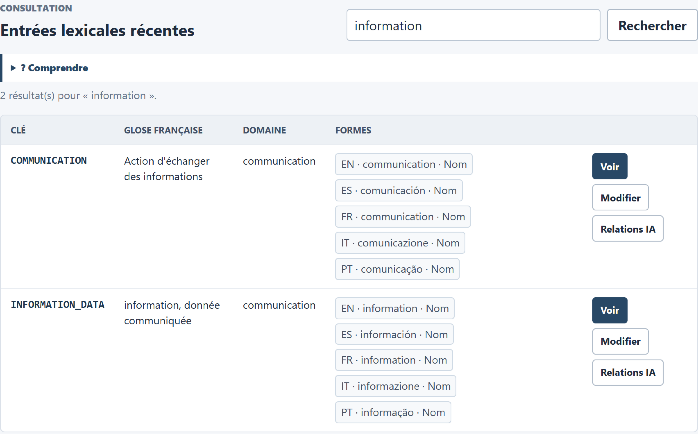
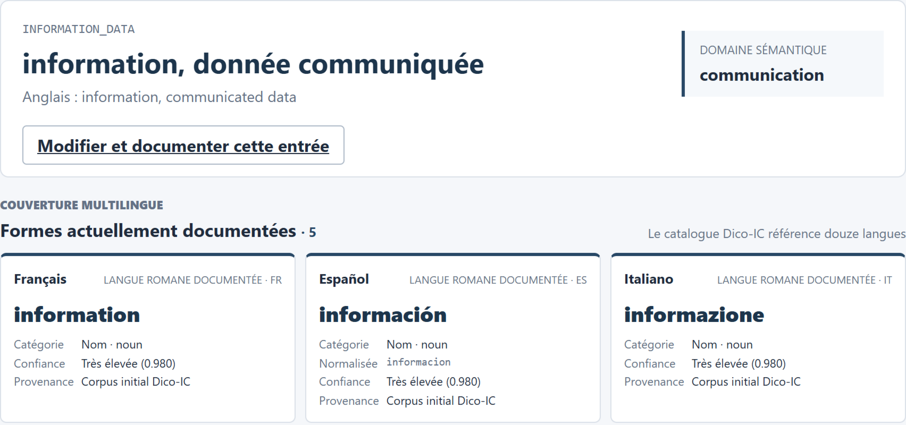
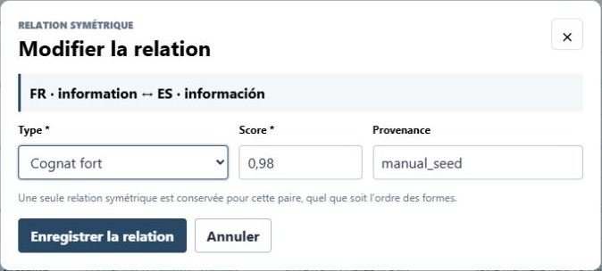
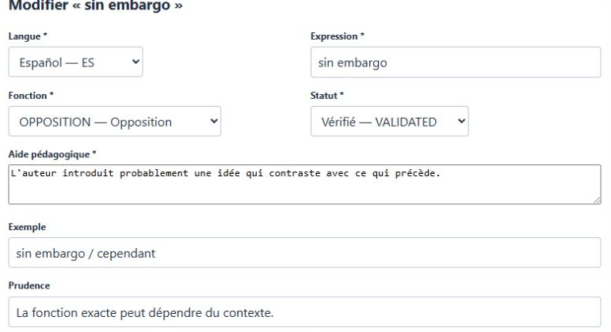
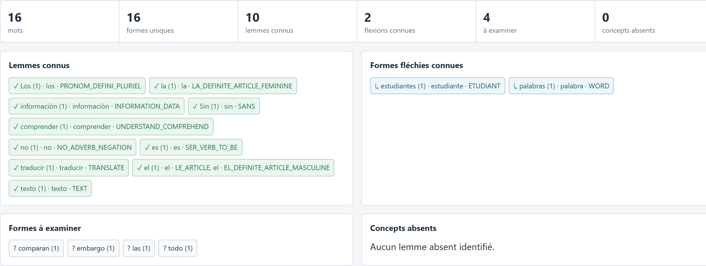

# Dico-IC
## Guide enseignant et professionnel

Consulter et enrichir les connaissances linguistiques · Édition du 9 septembre 2026

**Accès à Dico-IC : [adresse publique à compléter].**

Dico-IC rassemble des concepts, leurs mots dans plusieurs langues et des rapprochements utiles à la compréhension. Vous pouvez consulter et enrichir ces connaissances, qui alimentent notamment les indices et les aides à la lecture de Seven Sieves.

Ce prototype s’adresse aux enseignants et professionnels. Aucun compte personnel à créer ; les modalités d’accès vous seront communiquées.

### 1. Trouver une première entrée

1. Ouvrez Dico-IC. Dans **Admin principal**, cliquez sur **Lexique**.
2. Dans **Rechercher une entrée**, saisissez **information**, puis cliquez sur **Rechercher**.
3. Repérez la ligne **INFORMATION_DATA**, décrite par « information, donnée communiquée ». Cliquez sur **Voir** dans cette ligne.
4. La **Fiche conceptuelle** s’ouvre : elle présente le sens, les formes dans plusieurs langues et les relations déjà documentées.

*Figure 1. Deux résultats observés pour « information ». Le bouton « Voir » ouvre la fiche ; « Modifier » ouvre son atelier.*

La recherche porte sur **la clé, la glose française et le domaine sémantique**, sans rechercher directement tous les mots étrangers. En l’absence de résultat, essayez une explication en français ou un domaine, par exemple « communication ».

**← Retour au lexique** ramène à la liste. Effacez le champ, puis cliquez sur **Rechercher** pour tout afficher. Parcourez les résultats avec **Suivant →** et **← Précédent**.

<!-- pagebreak -->

### 2. Lire une fiche conceptuelle

Une **entrée** représente un sens. Sa **glose** est une courte explication, comme « information, donnée communiquée ». Sa **clé**, ici INFORMATION_DATA, permet de l’identifier sans ambiguïté. Le **domaine sémantique**, ici « communication », situe ce sens dans un thème.

Une **forme linguistique** associe un mot à ce sens dans une langue. Son **lemme** est la forme de référence du dictionnaire : « estudiante » pour le pluriel espagnol « estudiantes ». La **catégorie grammaticale** indique, par exemple, un nom ou un verbe.

*Figure 2. Haut de la fiche INFORMATION_DATA et trois de ses cinq formes. Le portugais et l’anglais se trouvent plus bas dans la même fiche.*

Dans cette entrée, « information », « información », « informazione » et « informação » renvoient au même sens. L’anglais fournit aussi une forme de comparaison. Cela ne constitue pas un outil de traduction de phrases.

- **Normalisée** : variante utilisée pour reconnaître le mot, parfois sans accents. Pour lire ou corriger son orthographe, référez-vous au lemme.
- **Provenance** : origine de l’information documentée.
- **Confiance** : degré de confiance associé à cette connaissance. Il accompagne la relecture professionnelle ; il ne garantit pas l’absence d’erreur.

### Comprendre les relations

Plus bas, **Relations documentées** présente les rapprochements effectivement enregistrés. Par exemple, « information ↔ información » est indiqué comme **Cognat fort**. L’absence d’une relation ne signifie pas que deux formes sont sans rapport : leur rapprochement peut simplement ne pas avoir été documenté.

Le **score**, compris entre 0 et 1, est une estimation provisoire de la transparence pédagogique du rapprochement. Ce n’est ni une probabilité ni une note attribuée à l’étudiant. **? Comprendre les relations** apporte des explications complémentaires.

Le catalogue référence douze langues. Le français, l’espagnol, l’italien et le portugais constituent le socle roman documenté ; l’anglais sert à la comparaison. Une langue indiquée **prête à documenter** peut recevoir des formes, mais reste inactive pour l’analyse.

<!-- pagebreak -->

### 3. Corriger une entrée ou en créer une

> **Avant d’enregistrer**
> Relisez le sens, la langue et l’orthographe. Les enregistrements modifient les connaissances partagées de Dico-IC ; ils ne créent pas une copie personnelle.
> Les formulaires ont été examinés pour ce guide. Les enregistrements décrits ci-dessous n’ont pas été essayés sur les données existantes.

### Corriger les informations existantes

1. Dans le lexique, cliquez sur **Modifier** dans la ligne concernée. Depuis une fiche, le lien **Modifier et documenter cette entrée** ouvre le même **Atelier de l’entrée**.
2. Cliquez sur **Modifier l’entrée**. Les gloses, le domaine, les lemmes et les catégories grammaticales déjà renseignés apparaissent dans un formulaire.
3. Corrigez les champs utiles. La glose française et chaque lemme doivent rester renseignés. La clé, les langues des formes et leurs provenances sont conservées.
4. Cliquez sur **Enregistrer**. En cas de réussite, le formulaire se ferme, les informations affichées sont actualisées et un message confirme la modification. Revenez à la fiche pour relire le résultat.

**Annuler** abandonne les corrections en cours et restaure les valeurs chargées. Si un message d’erreur apparaît, relisez-le et corrigez le champ concerné ; ne considérez pas la modification comme enregistrée.

L’atelier actuel corrige les formes déjà présentes. Il ne propose pas de bouton pour ajouter une langue ou supprimer une forme enregistrée.

### Ajouter un nouveau sens et ses formes

1. Recherchez d’abord le sens dans le **Lexique** pour éviter un doublon. Revenez ensuite à **Admin principal**, puis **Nouvelle entrée**.
2. Renseignez **Clé d’entrée** et **Glose française**. Pour une nouvelle clé, utilisez un nom de concept en français, en majuscules sans accents, avec des tirets bas entre les mots. Les anciennes clés, parfois en anglais, restent inchangées.
3. Complétez au besoin **Glose anglaise** et **Domaine sémantique**. Le domaine s’écrit en français naturel, avec accents et espaces.
4. Dans **Formes linguistiques**, choisissez la langue, saisissez le **Lemme** et choisissez la **Catégorie**. Au moins une forme doit être renseignée. **+ Ajouter une forme** ajoute une ligne ; **×** retire une ligne encore non enregistrée.
5. Cliquez sur **Créer l’entrée lexicale**. Après une création réussie, un message apparaît et le lexique recherche la clé créée. Cliquez sur **Voir** pour contrôler le sens et toutes les formes.

L’entrée et ses formes sont enregistrées ensemble. Une alerte **Doublon** invite à retrouver l’information existante ; changer artificiellement la clé ne résout pas un doublon de sens. **Effacer** vide le formulaire de création, sans supprimer d’entrée enregistrée.

<!-- pagebreak -->

### 4. Documenter des rapprochements et des pluriels

### Ajouter ou corriger une relation

1. Ouvrez l’**Atelier de l’entrée**, puis descendez à **Paires entre les formes documentées**.
2. Pour la paire voulue, cliquez sur **Ajouter la relation** si elle est absente, ou **Modifier la relation** si elle est déjà présente.
3. Choisissez le **Type**, renseignez le **Score** entre 0 et 1 et la **Provenance**. Cliquez sur **Enregistrer la relation**.
4. Après confirmation, le tableau est actualisé. La paire doit apparaître avec son type et son score ; la fiche de consultation permet de la relire. **Annuler** ferme le formulaire sans enregistrer.

*Figure 3. Relation existante « information ↔ información », ouverte puis refermée sans modification.*

- **Cognat fort** : rapprochement jugé nettement transparent ; **Cognat possible** : rapprochement plus incertain, à examiner.
- **Faux ami** : ressemblance susceptible d’induire en erreur sur le sens ; **Forme apparentée** : autre lien documenté entre formes.

Une seule relation symétrique est conservée par paire : inverser les deux formes n’en crée pas une nouvelle. Pour relier deux formes appartenant à des entrées différentes, allez dans **Admin principal > Relations**, recherchez et sélectionnez **Forme source** et **Forme cible**, puis renseignez type, score et provenance avant **Créer la relation**. Contrôlez le message et la liste **Relations récentes**. Aucun bouton de suppression de relation n’est proposé.

### Relier un pluriel à sa forme de référence

Dans **Formes fléchies**, un « mapping » désigne une association comme **estudiantes → estudiante**. Le périmètre actuel se limite aux pluriels de noms et d’adjectifs en français, espagnol, italien et portugais.

1. Recherchez d’abord la surface dans **Mappings récents**. Pour un ajout, recherchez puis sélectionnez le lemme dans **Forme canonique cible** : vérifiez sa langue, son sens et sa catégorie.
2. Saisissez **Surface fléchie**, puis le **Statut**, la **Confiance** et la **Provenance**. **Nombre** est limité au pluriel.
3. Cliquez sur **Créer le mapping**. Après le message de réussite, recherchez la surface dans **Mappings récents** et contrôlez la cible et le statut.

Seul **Vérifié — VALIDATED** est utilisé par l’analyse. **Proposé**, **Écarté** et **Archivé** n’y contribuent pas. La liste actuelle ne propose ni modification ni suppression d’un mapping : signalez une correction nécessaire au responsable de Dico-IC.

<!-- pagebreak -->

### 5. Préparer une aide à la lecture

Les **Aides discursives** expliquent le rôle probable d’une expression dans le texte : opposition, cause, conséquence, addition ou chronologie. Par exemple, « sin embargo » peut annoncer un contraste. L’aide guide la lecture sans imposer une interprétation valable dans tous les contextes.

### Consulter et corriger une aide

1. Dans **Admin principal > Aides discursives**, descendez au **Catalogue**. Recherchez une expression, puis utilisez au besoin les filtres de langue, de fonction et de statut.
2. Cliquez sur **Modifier** dans la ligne voulue. Le formulaire se remplit avec l’aide existante.
3. Relisez l’expression, sa **Fonction**, l’**Aide pédagogique**, l’**Exemple** et la **Prudence**. Vérifiez le **Statut**.
4. Cliquez sur **Enregistrer les modifications**. Un message confirme l’opération ; retrouvez l’aide dans le catalogue pour contrôler le résultat. **Annuler** quitte l’édition sans enregistrer.

*Figure 4. Champs de l’aide existante « sin embargo ». La prudence rappelle que sa fonction dépend du contexte. Aucune valeur n’a été changée.*

### Créer une aide ou la retirer de l’usage

Pour une nouvelle aide, utilisez le formulaire **Nouvelle aide discursive**. Renseignez **Langue**, **Expression**, **Fonction**, **Statut** et **Aide pédagogique**. Complétez les autres champs utiles, notamment exemple, prudence et provenance, puis cliquez sur **Créer l’aide**. Après confirmation, recherchez l’expression dans le catalogue. **Effacer** réinitialise le formulaire de création.

Une nouvelle aide est proposée par défaut. Choisissez **Vérifié — VALIDATED** seulement après relecture : ce statut rend l’aide utilisable dans une nouvelle analyse, si sa langue est active et documentée. Un rattachement à une entrée lexicale reste facultatif.

**Archiver**, dans le catalogue, demande une confirmation. Cette action passe l’aide au statut **Archivé** ; elle la conserve dans Dico-IC et la retire des aides utilisées par les analyses suivantes. Le filtre **Archivé** permet de la retrouver. Son formulaire **Modifier** permet ensuite de revoir son statut. Il ne s’agit pas d’une suppression définitive.

<!-- pagebreak -->

### 6. Examiner la couverture d’un texte

**IA Texte** commence par une comparaison avec les connaissances existantes. Le bouton **Analyser le texte** de cette première étape ne déclenche pas de génération IA et n’enregistre aucune connaissance.

1. Ouvrez **IA Texte**. Dans **Langue source**, choisissez **ES — Español**.
2. Dans **Texte à analyser**, saisissez cet exemple fictif :

> Los estudiantes comparan la información. Sin embargo, comprender las palabras no es traducir todo el texto.

3. Cliquez sur **Analyser le texte**. Le bilan distingue les lemmes connus, les flexions connues et les formes qui demandent un examen.

*Figure 5. Bilan observé : 10 lemmes connus, 2 flexions connues et 4 formes à examiner. Les résultats peuvent évoluer avec les connaissances documentées.*

Ici, **estudiantes** est relié à **estudiante**, et **palabras** à **palabra**. Les formes **comparan**, **embargo**, **las** et **todo** restent à examiner. Un mot non reconnu peut être une forme grammaticale, un élément d’expression ou un concept manquant : il ne faut pas créer automatiquement une nouvelle entrée pour chacun.

Le nombre **0 concepts absents** à cette étape ne signifie pas que tout est couvert. Les concepts à créer ne sont déterminés qu’après l’examen morphologique. Cette comparaison mot à mot ne mesure pas non plus toutes les aides disponibles dans Seven Sieves : l’expression « sin embargo » dispose, par exemple, d’une aide discursive distincte.

### Poursuivre avec l’assistance expérimentale

À l’étape **Assistant IA Formes Fléchies**, choisissez la **Taille du prochain lot**, puis le bouton d’examen. Son libellé s’adapte au nombre restant, par exemple **Examiner les 4 formes restantes**. Chaque lot est déclenché manuellement et sollicite le service IA extérieur.

Le résultat attendu est une liste de propositions à relire : surface, lemme, cible et contexte. Seules les lignes prêtes, indiquées **READY**, et explicitement cochées peuvent être enregistrées avec **Créer les mappings validés**. Les concepts encore manquants peuvent ensuite être proposés avec **Générer les concepts manquants**, puis relus à l’étape **Réviser les brouillons lexicaux**.

<!-- pagebreak -->

### 7. Utiliser les autres assistants IA

> **Des propositions à vérifier**
> Les générations IA sont expérimentales et dépendent d’un service extérieur susceptible d’entraîner un coût. Leur disponibilité ne se déduit pas du seul état de connexion de Dico-IC.
> Aucun appel IA ni enregistrement de proposition n’a été essayé pour ce guide. Les étapes ci-dessous décrivent le fonctionnement prévu par les commandes présentes et leur traitement.

### Partir d’un domaine pédagogique

1. Ouvrez **IA Domaine**. Renseignez **Domaine pédagogique**, **Nombre**, **Niveau approximatif**, langues cibles et catégories souhaitées.
2. Cliquez sur **Générer des propositions**. Le résultat attendu apparaît dans **Réviser les brouillons**, sous forme de concepts, gloses et formes modifiables.
3. Vérifiez chaque sens, chaque langue et chaque lemme. Corrigez les propositions utiles ; décochez celles que vous ne souhaitez pas retenir. Une suppression dans ce tableau retire seulement le brouillon.
4. Cliquez sur **Créer les entrées sélectionnées** pour enregistrer les lignes cochées et complètes. Lisez le bilan **Entrées créées**, **Doublons**, **Erreurs** et **Lignes ignorées**, puis retrouvez les entrées créées dans le lexique.

La révision et la création des brouillons lexicaux de **IA Texte** suivent le même principe. Une création par lot peut réussir pour certaines lignes et échouer pour d’autres : contrôlez le bilan avant de recommencer.

### Partir des formes d’une entrée

1. Dans **Admin principal > Lexique**, cliquez sur **Relations IA** dans la ligne de l’entrée voulue. Vérifiez la clé, la glose et les formes affichées dans **Entrée ciblée**.
2. Choisissez la **Langue de référence** pour organiser l’examen, puis cliquez sur **Proposer les relations**.
3. Relisez les paires, le type, le score et la justification. Ne gardez que les propositions nouvelles et pertinentes ; les relations déjà présentes ne doivent pas être recréées.
4. Cliquez sur **Créer les relations sélectionnées**. Consultez le bilan de création, puis la fiche pour vérifier les rapprochements effectivement enregistrés.

Le lien général **IA Relations**, sans entrée ciblée, peut afficher **Entrée manquante**. Revenez au lexique et utilisez **Relations IA** dans une ligne ; aucune manipulation d’adresse n’est nécessaire.

### En cas de résultat incomplet ou d’échec

- **Proposition douteuse ou incomplète** : corrigez-la ou décochez-la avant la création. Une justification produite par l’IA ne remplace pas une vérification linguistique.
- **Doublon** : consultez la connaissance existante. Ne relancez pas tout le lot sans lire ce qui a déjà été créé.
- **Génération impossible ou service indisponible** : gardez les éléments utiles ailleurs et transmettez le message au responsable de la démonstration. La consultation et les ajouts manuels restent des parcours distincts.

<!-- pagebreak -->

### 8. Préparer une activité Seven Sieves

**Accès à la préparation Seven Sieves : [adresse publique à compléter].**

Consultez Dico-IC lorsque vous choisissez un texte ou lorsque la prévisualisation donne peu d’indices sur un mot important. Vérifiez son sens, les formes dans les langues utiles, leurs relations, les pluriels attestés et les aides discursives. Toute connaissance ajoutée mérite une relecture avant utilisation pédagogique.

Le lien **Seven Sieves**, dans la navigation de Dico-IC, ouvre la préparation enseignante dans le même onglet. Depuis une fiche, revenez d’abord au lexique pour retrouver cette navigation. La préparation Seven Sieves ne comporte actuellement pas de lien de retour vers Dico-IC : ouvrez l’adresse de Dico-IC dans un autre onglet pour consulter pendant la préparation.

### Prendre en compte les connaissances enregistrées

Une **nouvelle analyse** Seven Sieves relit les connaissances alors disponibles dans les langues choisies. Une entrée, une relation ou un pluriel peut donc contribuer aux indices si les conditions de reconnaissance sont réunies. Les pluriels et les aides discursives doivent notamment avoir le statut **Vérifié — VALIDATED**. Une langue seulement prête à documenter reste inactive pour l’analyse.

Ce fonctionnement est établi par la lecture du traitement actuel. L’enchaînement « créer une connaissance, puis constater un nouvel indice » n’a pas été essayé pour ce guide, afin de préserver les données existantes. Un ajout ne garantit pas à lui seul un indice pour tous les contextes ni pour tous les tamis.

Après un enrichissement, revenez à la préparation et cliquez sur **Lancer l’analyse Dico-IC**, puis prévisualisez l’activité. Une activité déjà analysée ne s’actualise pas automatiquement. L’exemple fixe de démonstration reste un exemple prédéfini, indépendant de ces nouvelles analyses.

Pour le choix des langues, la prévisualisation et la conservation de l’activité, consultez le **guide enseignant Seven Sieves**, fourni avec celui-ci.

### 9. Conserver son travail et vérifier une action

> **Ce qui est conservé**
> Les connaissances dont l’enregistrement a réussi restent dans Dico-IC après fermeture de l’onglet. Elles sont partagées par les usages qui les consultent.
> Les saisies non enregistrées, les résultats de couverture et les brouillons IA restent temporaires. Gardez l’onglet ouvert pendant leur révision et notez ailleurs le texte, les propositions ou les observations à conserver.

**Enregistrer** et **Créer** demandent une écriture ; un message de réussite et une relecture de la fiche ou du catalogue permettent de la contrôler. **Annuler**, **Effacer** et la suppression d’un brouillon ne retirent pas une connaissance déjà enregistrée. Quitter ou recharger une page peut faire perdre le travail temporaire. Dans **IA Texte**, une nouvelle analyse réinitialise les propositions en cours.

Si l’affichage ne correspond pas à ce que vous venez d’enregistrer, relisez le message, puis recherchez à nouveau la connaissance. En cas d’incertitude après une interruption, vérifiez d’abord si elle existe avant de répéter l’enregistrement. Pour une information enregistrée dont l’interface ne permet pas la suppression ou la correction, adressez-vous au responsable de Dico-IC.
