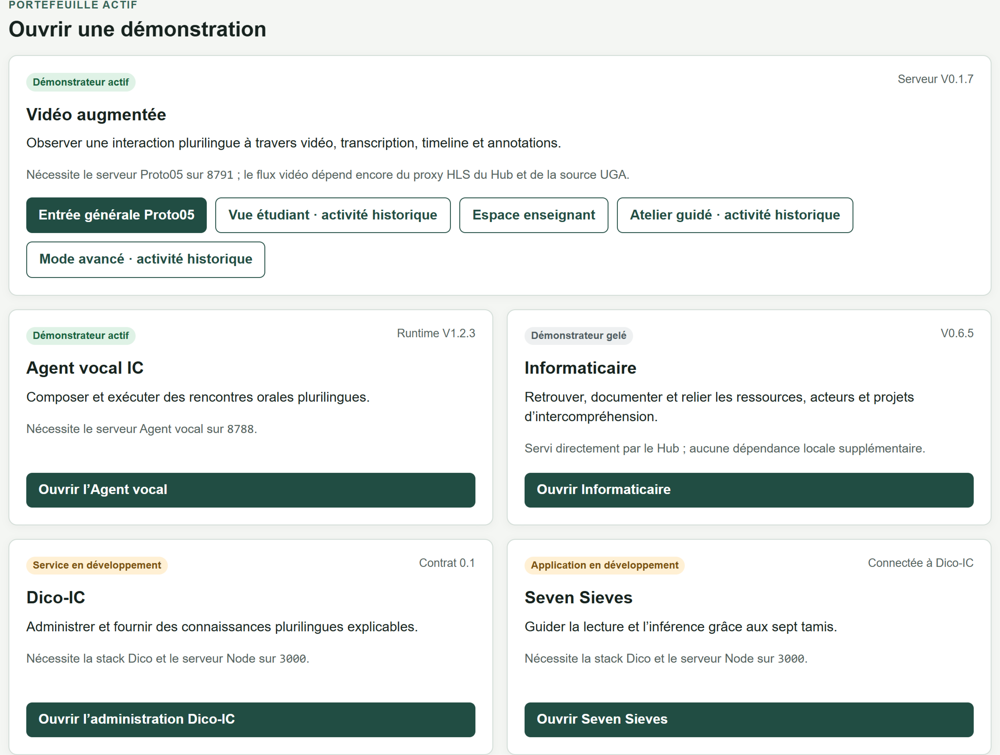

# IC-Hub
## Guide de prise en main

Pour les enseignants et professionnels · Édition du 9 septembre 2026

IC-Hub est le portail d’accès aux démonstrateurs IC-Lab-Next. Choisissez un outil selon votre besoin, puis poursuivez dans son interface avec le guide détaillé correspondant.

**Adresse du portail : [URL publique à compléter].**
**Modalités d’accès : [à compléter lors de la mise à disposition].**

### Repérer les accès

Dans **Ouvrir une démonstration**, chaque carte présente un outil. La carte **Vidéo augmentée** propose plusieurs parcours ; les quatre autres cartes ont chacune un bouton d’ouverture. Faites défiler la page pour les voir tous.

*Accueil, zone « Ouvrir une démonstration ». Les parcours vidéo sont en haut ; les quatre autres outils sont en dessous. Les libellés des accès sont repris page suivante.*

### Ouvrir un outil et revenir

Cliquez sur le bouton choisi : l’outil s’ouvre dans le même onglet. Utilisez **Précédent** dans le navigateur pour revenir au portail ; après plusieurs déplacements, rouvrez l’adresse du portail. Pour garder l’accueil disponible, vous pouvez ouvrir un lien dans un nouvel onglet depuis le menu du clic droit.

Le bouton **Mon espace local**, situé plus haut dans l’accueil, ne fait pas partie du parcours de cette livraison. Utilisez les cartes des démonstrateurs.

<!-- pagebreak -->

## Choisir le bon parcours

| Votre besoin | Outil | Accès à choisir |
| --- | --- | --- |
| Préparer une lecture avec les sept tamis | Seven Sieves | **Ouvrir Seven Sieves** : ouvre la préparation enseignant. |
| Consulter ou enrichir les connaissances linguistiques | Dico-IC | **Ouvrir l’administration Dico-IC** : réservé aux enseignants et professionnels. |
| Trouver une ressource et explorer ses relations | Informaticaire | **Ouvrir Informaticaire** : ouvre l’accueil de consultation. |
| Choisir une activité vidéo à préparer ou à présenter | Vidéo augmentée | **Espace enseignant** : ouvre la bibliothèque d’activités. |
| Découvrir l’activité vidéo de démonstration | Vidéo augmentée | **Vue étudiant · activité historique** : ouvre la consultation de cette activité. |
| Découvrir les activités de rencontres orales plurilingues | Agent vocal IC | **Ouvrir l’Agent vocal** : ouvre sa bibliothèque d’activités. |

Pour la vidéo, **Entrée générale Proto05** ouvre aussi la consultation de la démonstration. **Atelier guidé · activité historique** et **Mode avancé · activité historique** ouvrent ses deux parcours de préparation. Pour commencer, choisissez **Espace enseignant** et consultez le guide enseignant.

> **Transmettre un accès aux étudiants**
> Transmettez l’accès au parcours étudiant approprié et son guide, plutôt que ce portail professionnel. Pour la vidéo, choisissez l’activité à transmettre ; « activité historique » désigne la démonstration déjà proposée. Pour Seven Sieves, suivez les consignes du guide enseignant : une adresse seule ne transporte pas votre préparation.
> Dico-IC est exclusivement destiné aux enseignants et professionnels. Cette répartition des publics est une consigne d’usage ; la livraison ne comporte pas de gestion des utilisateurs.

### Retrouver les guides détaillés

Les guides accompagnent la livraison ; l’accueil ne propose pas de bouton pour les ouvrir. Dans le dossier des guides utilisateurs, consultez :

- **Seven Sieves** : [Guide enseignant](../seven-sieves/guide-enseignant.pdf) et [Guide étudiant](../seven-sieves/guide-etudiant.pdf).
- **Dico-IC** : [Guide enseignant et professionnel](../dico-ic/guide-enseignant.pdf).
- **Vidéo augmentée** : [Guide enseignant](../video-augmentee/guide-enseignant.pdf) et [Guide étudiant](../video-augmentee/guide-etudiant.pdf).
- **Informaticaire** : [Guide de consultation](../informaticaire/guide-utilisateur.pdf).

Pour l’Agent vocal, demandez les consignes à la personne qui organise la démonstration ; aucun guide utilisateur dédié n’accompagne actuellement ces documents.

### Si un outil ne s’ouvre pas

Revenez au portail et signalez à la personne qui vous a communiqué l’accès le nom de l’outil et le message affiché. L’ouverture du portail ne garantit pas que chaque outil soit disponible.
