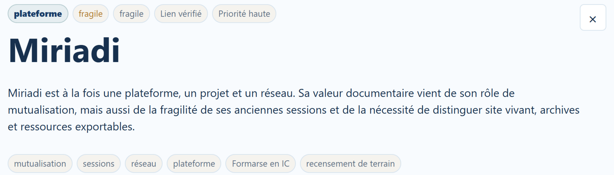
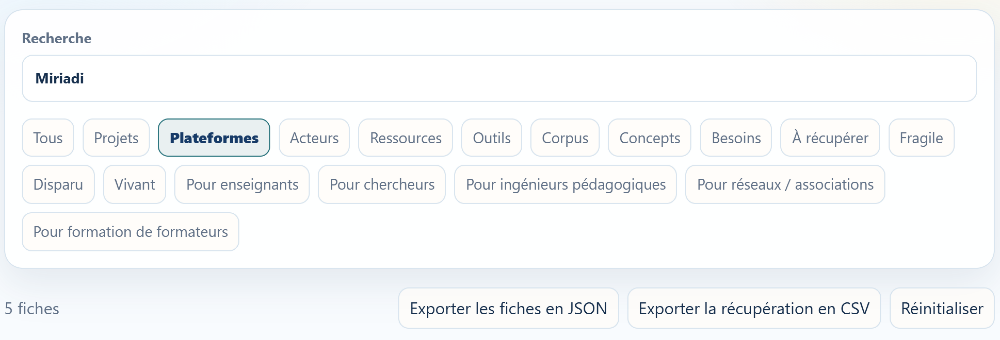
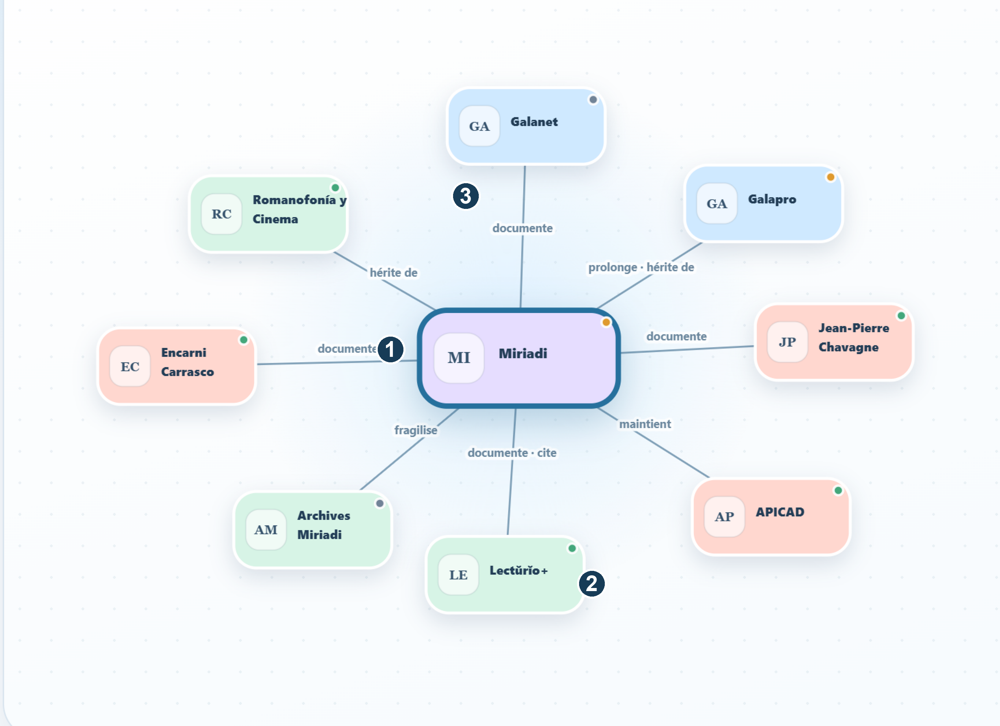
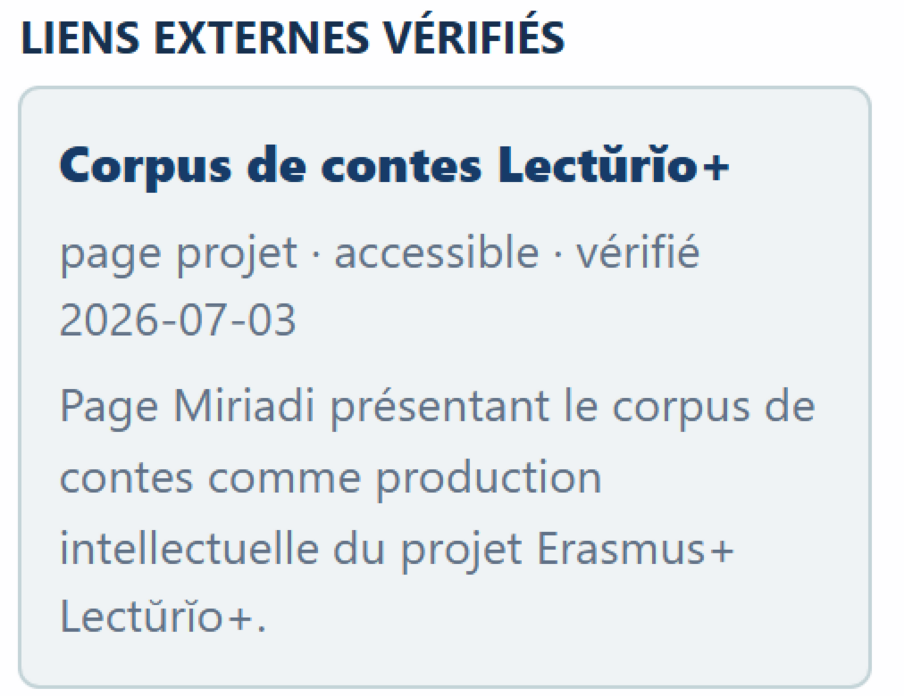

# Informaticaire
## Guide de consultation

Pour les enseignants, étudiants et autres lecteurs qui souhaitent découvrir les ressources de l’intercompréhension et comprendre leurs relations.

**Adresse publique : [URL À COMPLÉTER]**
**Modalités d’accès : [À COMPLÉTER — elles vous seront communiquées.]**

Informaticaire rassemble des fiches sur des projets, personnes, plateformes, ressources et notions. Une fiche décrit un élément ; elle peut vous orienter vers d’autres fiches ou vers un site extérieur.

### Un premier parcours : de Miriadi à un corpus de contes

1. Depuis l’accueil, saisissez **Miriadi** dans **Rechercher un projet, une personne, une ressource…**, puis cliquez sur **Rechercher**. La bibliothèque s’ouvre ; la fiche intitulée **Miriadi** apparaît en premier.
2. Cliquez sur **Ouvrir la fiche** sous ce résultat. Lisez sa présentation et les indications d’usage.
3. Descendez dans la fenêtre jusqu’à **FICHES LIÉES**, puis cliquez sur **Lectŭrĭo+**. Sa fiche remplace celle de Miriadi : elle présente une ressource de contes plurilingues.
4. Dans **LIENS EXTERNES VÉRIFIÉS**, cliquez sur **Corpus de contes Lectŭrĭo+**. La page **Corpus de contes** du site Miriadi s’ouvre dans un nouvel onglet.
5. Revenez à l’onglet Informaticaire. Cliquez sur **Miriadi** dans les fiches liées pour retrouver cette fiche, ou sur **×** pour revenir à la bibliothèque.

*Le titre et la description permettent de vérifier que vous avez ouvert la bonne fiche. Les étiquettes donnent des repères complémentaires, à interpréter avec les rubriques détaillées.*

### Retrouver une explication

Rechercher et filtrer : **p. 2** · Lire une fiche et ses liens : **p. 3** · Explorer la carte : **p. 4** · Consulter une ressource et garder une référence : **p. 5**.

> **Un point de départ documentaire**
> Le corpus est limité et n’est pas une base officielle exhaustive. Une recherche sans résultat ne prouve pas l’absence de ressources sur le sujet.

<!-- pagebreak -->

## Rechercher et affiner les résultats

Ouvrez **Explorer**, puis **Toutes les fiches**. Saisissez un nom ou quelques mots dans **Recherche** : les résultats et leur nombre se mettent à jour pendant la saisie.

La recherche porte sur les titres et les variantes de noms, mais aussi sur les descriptions, mots-clés, acteurs, relations, sources et autres informations des fiches. Un résultat peut donc parler de Miriadi sans porter ce titre. Les correspondances dans les titres et leurs variantes sont placées en premier.

Les majuscules, accents et différences d’espacement ne bloquent pas la recherche. Essayez par exemple **EuRom5** pour retrouver **EuRom / EuRom Web**. Certaines variantes sont reconnues ; cela ne signifie pas que toutes les fautes de frappe ou tous les synonymes sont compris. Privilégiez un nom ou une expression courte.

*Le filtre Plateformes réduit ici la recherche Miriadi à cinq fiches. Le mot recherché reste présent dans le champ.*

### Choisir un filtre

- **Projets**, **Plateformes**, **Acteurs**, **Ressources**, **Outils**, **Corpus**, **Concepts** ou **Besoins** : choisir un type de fiche.
- **À récupérer**, **Fragile**, **Disparu** ou **Vivant** : choisir un état documentaire.
- **Pour enseignants**, **Pour chercheurs**, **Pour ingénieurs pédagogiques**, **Pour réseaux / associations** ou **Pour formation de formateurs** : choisir un public mentionné.

**Un seul filtre est actif à la fois.** Cliquer sur un autre le remplace, tout en conservant la recherche saisie. **Tous** retire le filtre mais garde le texte. **Réinitialiser** efface la recherche et rétablit **Tous**.

### Si rien ne correspond

Revenez à **Tous**, raccourcissez votre recherche ou essayez une variante du nom. Si nécessaire, cliquez sur **Réinitialiser** pour parcourir l’ensemble du corpus. L’absence de résultat peut venir du filtre, du vocabulaire utilisé ou du périmètre des fiches.

Les vues **À partager** et **À sauver / vérifier**, sous **Explorer**, proposent d’autres sélections de consultation : fiches à montrer en priorité et patrimoine fragile. Elles ne constituent pas des filtres supplémentaires appliqués à votre recherche.

<!-- pagebreak -->

## Lire une fiche et ses liens

Dans la bibliothèque, cliquez sur **Ouvrir la fiche**, ou sur le corps de la carte. Une fenêtre de détail apparaît. Faites défiler cette fenêtre pour lire la suite ; **×**, en haut à droite, ou la touche **Échap** la ferme.

| Rubrique | Ce qu’elle vous apprend |
| --- | --- |
| Type et présentation | La nature de l’élément et son rôle : plateforme, projet, personne, ressource ou notion. |
| À QUOI ÇA SERT ? / POUR QUI ? | L’intérêt de la fiche et les publics auxquels elle peut servir. |
| COMMENT RÉUTILISER ? | Une piste pour adapter ou mobiliser la ressource. |
| DROITS / LICENCE / ACCESSIBILITÉ | Les indications connues sur le réemploi et les conditions d’accès. « Inconnu » ou « à vérifier » signale une information à confirmer. |
| ÉTAT ACTUEL / PRIORITÉ COMMUNAUTAIRE | L’état documenté et l’intérêt collectif accordé au suivi de la ressource. Ce ne sont pas des notes de qualité pédagogique. |
| TRAÇABILITÉ DOCUMENTAIRE / TRAÇABILITÉ | L’origine des informations, les témoignages ou notes qui les étayent, et les indications de confiance ou de vérification. |
| RISQUES / NOTES D’INCERTITUDE | Les fragilités, informations manquantes et précautions utiles à la lecture. |

Un état **vivant** ou un badge **Lien vérifié** ne garantit pas que tous les contenus soient disponibles aujourd’hui ou réutilisables librement. Lisez les dates, les notes et les indications propres à chaque lien. Une rubrique peut rester incomplète.

### Suivre un lien interne

**FICHES LIÉES** ouvre une autre fiche dans la même fenêtre. Pour revenir à la précédente, utilisez son nom parmi les liens de la nouvelle fiche lorsqu’il est proposé ; sinon, fermez la fenêtre et retrouvez-la dans la bibliothèque. Il n’y a pas de bouton de retour entre les fiches de cette fenêtre.

Dans les cartes de la bibliothèque, les boutons de **LIÉ À** ont un autre effet : ils ciblent la fiche correspondante dans les résultats. Cliquez ensuite sur **Ouvrir la fiche**. **Réinitialiser** permet de repartir de toutes les fiches.

### Comprendre une relation

**RELATIONS TYPÉES** précise la nature du lien : par exemple **hérite de**, **prolonge**, **documente** ou **cite**. Lisez aussi la note qui explique le rapprochement. Il s’agit de relations documentaires renseignées dans le corpus, parfois assorties d’incertitudes.

Les simples **FICHES LIÉES** et les relations typées ne sont pas équivalentes. La carte représente les relations typées, entrantes et sortantes. Une fiche peut donc avoir des liens internes tout en affichant **0 relation** dans la carte.

<!-- pagebreak -->

## Explorer la carte de proche en proche

Sur une carte de résultat, cliquez sur **Voir dans la carte**. Vous pouvez aussi ouvrir **Carte**, puis **Voisinage interactif**, et choisir un titre dans **Explorer le voisinage de…**. Le nombre associé au titre indique combien de relations typées touchent cette fiche.

*1. Fiche au centre. 2. Fiche voisine. 3. Relation nommée. Extrait du voisinage direct de Miriadi ; le panneau de relations est à côté ou en dessous selon la largeur de l’écran.*

### Ce que montre la carte

La fiche au centre est plus grande et encadrée : c’est celle dont vous explorez le voisinage. La couleur de fond indique la famille : **bleu pour Projet**, **violet pour Plateforme**, **vert pour Ressource** (dont outils et corpus), **saumon pour Acteur**, **jaune pour Concept / repère**.

La disposition facilite la lecture. Les distances et les positions ne mesurent ni l’importance ni la proximité scientifique des éléments. Pour connaître l’état d’une fiche, lisez son libellé dans le panneau ou ouvrez sa fiche complète.

### Choisir une relation et poursuivre

1. Dans **RELATIONS DOCUMENTÉES**, lisez le nom et la note. Pour connaître le sens d’une relation, fiez-vous aux mentions “Depuis cette fiche” et “Vers cette fiche” dans le panneau, plutôt qu’à l’orientation des flèches du dessin.
2. Cliquez sur **Recentrer**, ou sur le nœud correspondant dans le dessin. La fiche choisie devient le nouveau centre ; son voisinage et le panneau sont actualisés.
3. **Consulter la fiche** ouvre le détail d’un voisin. **Consulter la fiche complète**, au bas du panneau, ouvre celui du centre. Fermez la fenêtre pour retrouver la carte.

Pour retrouver Miriadi, choisissez de nouveau **Miriadi** dans **Explorer le voisinage de…**. Plusieurs relations peuvent relier les mêmes deux fiches : leur nombre n’est donc pas le nombre de voisins. **Lectures guidées** propose, dans la même rubrique Carte, des chaînes commentées en colonnes ; **Voisinage interactif** ramène au dessin.

<!-- pagebreak -->

## Consulter une ressource et garder sa référence

### Passer d’une fiche au site extérieur

Dans **LIENS EXTERNES VÉRIFIÉS**, cliquez sur le titre de la ressource. Un nouvel onglet s’ouvre ; celui d’Informaticaire reste disponible avec la fiche en cours. Revenez à cet onglet pour continuer votre exploration.

*Dans la fiche Lectŭrĭo+, ce lien ouvre la page Corpus de contes du site Miriadi.*

Cette rubrique peut mêler des liens portant une date de vérification et des liens simplement **recensés**, avec **vérifié à dater**. Lisez chaque indication séparément. Si une destination échoue ou demande un accès particulier, revenez à la fiche et essayez une autre ressource proposée.

### Étendre la recherche depuis Miriadi

La fiche **Miriadi** propose **EXPLORER LES RESSOURCES DE MIRIADI**. Saisissez quelques mots dans **Que cherchez-vous dans miriadi.net ?**, puis cliquez sur **Rechercher dans Miriadi**.

Un moteur de recherche externe s’ouvre dans un nouvel onglet avec une recherche limitée au domaine miriadi.net. Ses résultats dépendent de ce moteur et de ce qu’il connaît du site. Cette commande ne complète pas les fiches d’Informaticaire et ne change pas votre recherche dans la bibliothèque.

### Garder une référence utile

Notez le **titre de la fiche** et l’adresse d’Informaticaire dans votre document de travail. Pour une ressource externe, vous pouvez aussi conserver l’adresse de la page ouverte, par copie ou favori du navigateur.

**Exporter les fiches en JSON**, dans **Toutes les fiches**, télécharge une copie de l’ensemble du corpus, même si une recherche ou un filtre est actif. Le message de génération confirme le déclenchement ; retrouvez ensuite le fichier dans les téléchargements. Cet export conserve des données documentaires, pas votre parcours de lecture. **Exporter la récupération en CSV** concerne uniquement les fiches dotées d’informations de récupération, et non la sélection de recherche.

> **Ce que l’adresse et le rechargement conservent**
> L’adresse peut retrouver la vue ouverte, par exemple la bibliothèque ou la carte. Elle ne mémorise ni la fiche de détail, ni le centre choisi dans le graphe, ni vos critères de recherche.
> Au rechargement, la bibliothèque revient à une recherche vide avec **Tous** ; la carte revient sur **Miriadi**. Notez les titres utiles avant de fermer. Changer simplement de vue dans l’onglet conserve en revanche la recherche et le centre choisis.
