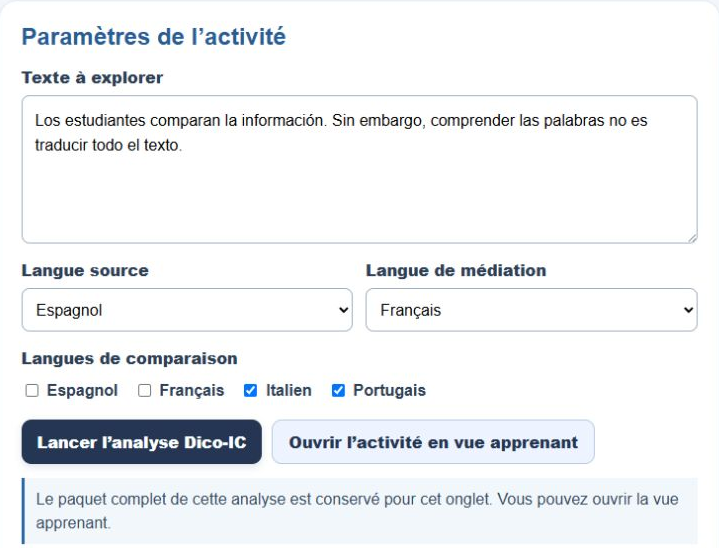
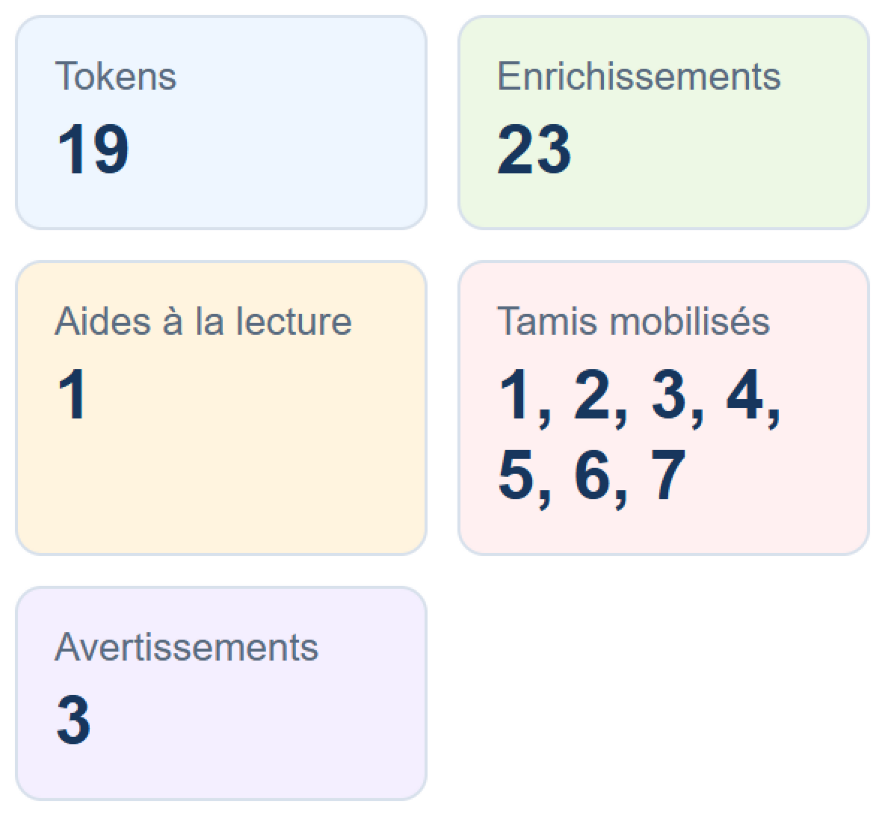

# Seven Sieves
## Guide enseignant

Préparer une première exploration · Édition du 9 septembre 2026

**Accès à la préparation : [adresse publique à compléter].**

Seven Sieves aide à comprendre un texte dans une langue romane en rapprochant des mots, des formes et des structures. Vous choisissez le texte et les langues ; l’étudiant explore ensuite les indices proposés par les sept tamis.

Cette version est un prototype de démonstration. Aucun compte personnel à créer ; les modalités d’accès vous seront communiquées. Les indices disponibles ne couvrent pas tous les mots.

### 1. Choisir le texte et les langues

1. Ouvrez l’adresse de préparation. Dans **Texte à explorer**, remplacez le texte proposé par votre court texte. Pour essayer, copiez cet exemple fictif :

> Los estudiantes comparan la información. Sin embargo, comprender las palabras no es traducir todo el texto.  

2. Dans **Langue source**, choisissez la langue du texte : **Espagnol** pour cet exemple.
3. Dans **Langue de médiation**, choisissez une langue d’appui familière aux étudiants : **Français** ici. Ce choix sert aux rapprochements proposés ; il ne traduit pas tout le texte.
4. Dans **Langues de comparaison**, cochez **Italien** et **Portugais** pour cet essai. Ces langues offrent d’autres formes à rapprocher.

*Figure 1. Exemple saisi, espagnol source, français médiation, italien et portugais en comparaison. Le bouton d’ouverture est disponible ici après l’analyse.*

Les choix proposés dans cette page sont **Espagnol**, **Français**, **Italien** et **Portugais**. Choisissez des langues de comparaison différentes de la langue source : celle-ci est écartée de la comparaison même si vous la cochez. Les sept tamis sont demandés automatiquement à l’analyse.

<!-- pagebreak -->

### 2. Analyser et lire le résultat

1. Cliquez sur **Lancer l’analyse Dico-IC**. Les paramètres sont temporairement bloqués pendant le traitement. **Annuler l’analyse** permet d’interrompre l’attente ; il faudra relancer une analyse pour ouvrir l’activité.
2. Attendez **Activité prête**. Le bouton **Ouvrir l’activité en vue apprenant** devient disponible.
3. Consultez le **Résumé de préparation**. Pour le texte de la figure 1, l’essai a donné 23 enrichissements, une aide à la lecture et des indices sur les sept tamis. Un autre texte peut donner moins d’indices.

*Figure 2. Zoom sur les résultats du « Résumé de préparation ». Les trois avertissements signalent le caractère expérimental des tamis 4, 5 et 6 ; l’activité est néanmoins prête.*

- **Tokens** : nombre d’éléments découpés dans le texte, ponctuation comprise.
- **Enrichissements** : nombre d’indices produits ; un mot peut en recevoir plusieurs.
- **Aides à la lecture** : repères sur certaines expressions qui organisent le texte.
- **Tamis mobilisés** : tamis pour lesquels au moins un indice a été trouvé.
- **Avertissements** : limites annoncées par l’analyse. Leur présence ne signifie pas à elle seule que le traitement a échoué.

### 3. Prévisualiser l’exploration

Cliquez sur **Ouvrir l’activité en vue apprenant**. Le même onglet affiche **Explorer avec les sept tamis**, avec votre texte et vos langues. C’est la vue utilisée pour explorer ; il n’existe pas de bouton de prévisualisation séparé.

Avec le texte de la figure 1, cliquez sur **1. Lexique international**, puis sur « información ». Vérifiez l’indice « información → information ». Essayez **Montrer les indices** et **Afficher les aides à la lecture (1)**. Le guide étudiant explique le parcours complet.

Cliquez sur **Retour à la préparation** pour retrouver la préparation. Si vous changez le texte ou une langue, **Nouvelle analyse nécessaire** apparaît : relancez l’analyse avant de rouvrir la vue apprenante.

Pour consulter les connaissances qui alimentent les indices ou préparer un enrichissement, reportez-vous au **guide enseignant et professionnel Dico-IC**, fourni avec ce guide. **Accès à Dico-IC : [adresse publique à compléter].** Ouvrez-le dans un autre onglet pour conserver votre préparation.

<!-- pagebreak -->

### 4. Conserver et faire essayer l’activité

> **À garder pour la suite**  
> Gardez l’onglet de l’activité ouvert et conservez ailleurs **le texte et les choix de langues**.  
> Les sélections et les choix **Compris**, **Doute**, **Inconnu** des étudiants ne sont pas sauvegardés ni transmis à l’enseignant.  
> Après fermeture de l’onglet, ne comptez pas sur une récupération de la préparation.  

| Action | Conséquence |
| --- | --- |
| Recharger la préparation ou y revenir depuis la vue apprenante | La préparation déjà analysée reste disponible dans le même onglet. |
| Modifier le texte ou les langues | Le résultat est retiré. Analysez à nouveau : les modifications non analysées ne sont pas sauvegardées. |
| Relancer l’analyse | Le résultat précédent n’est plus utilisable, même en cas d’échec ou d’annulation. |
| Recharger la vue apprenante ou cliquer sur Recommencer | Le texte préparé reste présent ; la sélection et les choix de compréhension sont réinitialisés. |

Pour faire essayer **votre préparation**, ouvrez la vue apprenante sur ce poste, dans cet onglet. **Une adresse copiée seule ne transmet pas la préparation.** Sur un autre poste, il faut préparer et analyser le texte à nouveau.

### Une autre entrée : l’exemple de démonstration

**Accès à l’exemple fixe : [adresse publique de démonstration à compléter].** Ce lien ouvre le texte prédéfini « Durante el día… », indépendamment de votre préparation. Utilisez un onglet distinct : il remplace la préparation éventuelle de l’onglet utilisé. Le recharger remet l’exemple et l’exploration à leur état initial.

### En cas de difficulté

- **Texte requis** : saisissez un texte dans **Texte à explorer**, puis relancez.
- **Bouton d’ouverture grisé** : attendez **Activité prête**. Après un changement de paramètre, relancez l’analyse.
- **Peu d’indices ou des avertissements** : vérifiez la langue source et prévisualisez les mots utiles. Une absence d’indice n’est pas une panne ; essayez un autre tamis ou un autre court texte.
- **Aucune activité n’a encore été préparée.** : revenez à la préparation et ouvrez l’activité depuis son bouton, dans le même onglet.
- **Analyse impossible** ou **Délai d’analyse dépassé** : ces messages signalent un échec, contrairement à un résultat pauvre en indices. Gardez votre texte, puis signalez le message à la personne responsable de la démonstration.
