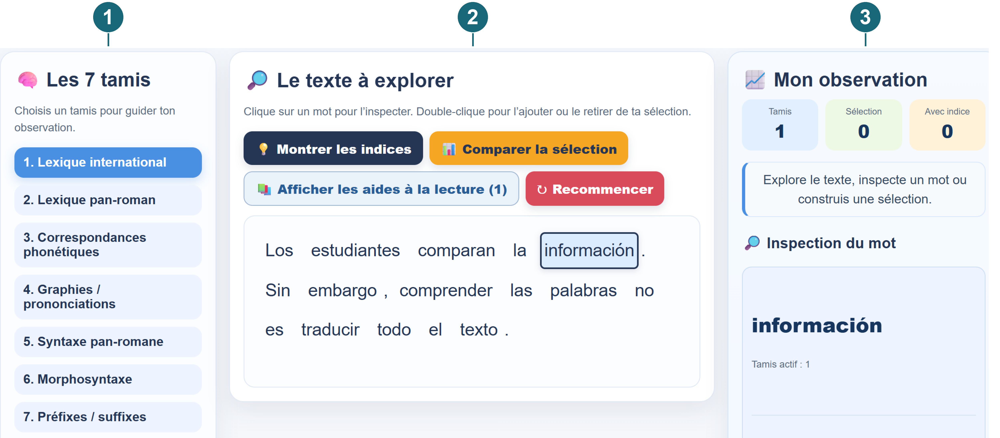
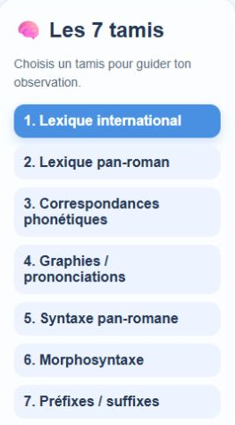
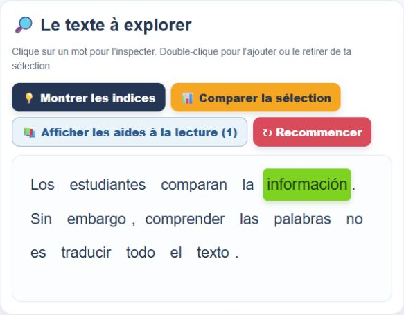
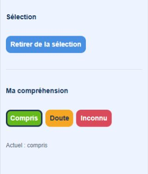
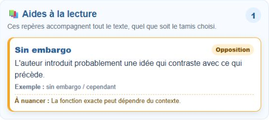

# Seven Sieves
## Guide étudiant

Explorer une activité déjà ouverte · Édition du 9 septembre 2026

**Accès : [adresse publique à compléter].** Pour une activité préparée par l’enseignant, commencez dans l’onglet où il a ouvert l’exploration. Une adresse copiée seule ne transporte pas cette préparation.

Seven Sieves vous aide à comprendre un texte dans une langue romane grâce aux ressemblances entre langues et aux indices du texte. Cherchez à construire son sens, sans traduire chaque mot. Il s’agit d’un prototype de démonstration. Aucun compte personnel à créer ; les modalités d’accès vous seront communiquées.

*Figure 1. 1 : choisir un tamis. 2 : explorer le texte. 3 : lire l’observation et inspecter un mot. Les captures de détail précisent les commandes dans la suite du guide.*

### 1. Réussir une première exploration

1. Lisez le texte une première fois. Sous le titre, **Source** indique sa langue, **Médiation** la langue d’appui et **Comparaison** les autres langues utilisées. ES = espagnol, FR = français, IT = italien, PT = portugais.
2. Cliquez sur **1. Lexique international** dans **Les 7 tamis**. Cherchez un mot qui vous semble reconnaissable.
3. Cliquez une fois sur ce mot. **Inspection du mot**, dans **Mon observation**, affiche les indices disponibles. Faites défiler la page si nécessaire.
4. Double-cliquez sur un mot utile pour l’ajouter à **Ma sélection**. Un autre double-clic le retire. Vous pouvez aussi utiliser **Ajouter à la sélection** dans l’inspection.
5. Cliquez sur **Montrer les indices**, puis sur **Comparer la sélection**. Lisez le retour dans **Mon observation**.
6. Choisissez un autre tamis pour compléter votre hypothèse. À la fin, reformulez le sens du texte avec vos propres mots, à l’oral ou dans vos notes.

**Un clic inspecte ; un double-clic sélectionne.** L’inspection n’ajoute pas automatiquement le mot à la sélection. Les indices sont des pistes à vérifier dans la phrase.

<!-- pagebreak -->

### 2. Choisir un tamis

Les tamis sont sept façons de regarder le même texte. Vous pouvez changer de tamis dans l’ordre qui vous aide. Votre sélection et vos choix de compréhension restent présents pendant ce changement.

*Figure 2. Cliquez sur le nom d’un tamis. La zone « Tamis actif » précise ce qu’il invite à observer.*

| Tamis | Que regarder ? |
| --- | --- |
| 1. Lexique international | Les mots reconnaissables dans la langue d’appui. Dans l’exemple : información → information. |
| 2. Lexique pan-roman | Les formes apparentées dans plusieurs langues romanes, par exemple información, information, informazione, informação. |
| 3. Correspondances phonétiques | Les correspondances proposées entre formes, comme -ción → -tion. |
| 4. Graphies / prononciations | Des lettres ou groupes de lettres qui orientent la prononciation. Les repères sont écrits ; cette vue ne propose pas de bouton d’écoute. |
| 5. Syntaxe pan-romane | Des rôles probables dans la phrase, par exemple un verbe. Vérifiez toujours avec le contexte. |
| 6. Morphosyntaxe | Des signaux grammaticaux, comme un pluriel ou un infinitif probable. |
| 7. Préfixes / suffixes | Des débuts ou fins de mots qui aident à reconnaître une famille de mots. |

Les tamis 4, 5 et 6 proposent encore des indices expérimentaux. Les rapprochements ne constituent pas une traduction certaine. Un mot peut recevoir des indices dans plusieurs tamis, dans un seul ou dans aucun.

<!-- pagebreak -->

### 3. Inspecter, choisir et comparer

Cliquez sur un mot puis lisez **Inspection du mot**. Dans **Indice du tamis actif**, vous trouverez le détail disponible. **Vue des sept tamis** indique les autres pistes associées à ce mot : cliquez sur le tamis correspondant pour en lire le détail.

<!-- figures-pair -->

*Figure 3. « información » est sélectionné et marqué comme compris. Votre texte peut être différent.*

*Figure 4. « Compris » est une appréciation personnelle, que vous pouvez changer.*

<!-- end-figures-pair -->

Dans **Ma compréhension**, cliquez sur **Compris**, **Doute** ou **Inconnu**. Ce choix décrit votre compréhension de ce mot à cet endroit du texte. Il n’est pas corrigé automatiquement.

| Commande ou repère | Résultat |
| --- | --- |
| Ajouter à la sélection / Retirer de la sélection | Ajoute ou retire le mot inspecté, comme le double-clic. |
| Montrer les indices | Met en évidence les mots ayant un indice pour le tamis actif. Après un changement de tamis, la mise en évidence suit ce nouveau tamis. |
| Comparer la sélection | Indique combien de mots sélectionnés disposent d’un indice pour le tamis actif. |
| Sélection / Avec indice | Affiche le nombre de mots sélectionnés / ceux qui ont un indice dans ce tamis. Ce n’est pas une note. |
| Indices et transformations | Rassemble les indices du tamis actif pour le texte, au-delà de votre seule sélection. |

**Aucun indice reçu pour ce tamis.** ne signifie pas que votre idée est fausse. Essayez un autre tamis, regardez les mots voisins et confrontez vos hypothèses au sens de la phrase. Avec le texte illustré, « estudiantes » n’a pas d’indice au tamis 1, mais en a aux tamis 2 et 6.

<!-- pagebreak -->

### 4. Utiliser les aides et terminer

Cliquez sur **Afficher les aides à la lecture (1)**. Le nombre varie selon le texte. Les expressions concernées sont repérées et leurs fiches apparaissent en dessous. Si le bouton est absent, aucune aide de ce type n’est disponible : continuez avec les tamis.

Cliquez sur une fiche ou sur un mot de l’expression repérée pour faire ressortir le lien entre la fiche et le texte. Ces aides restent utiles quel que soit le tamis choisi. **Masquer les aides à la lecture** les cache à nouveau.

*Figure 5. « Sin embargo » peut annoncer une opposition avec ce qui précède. Vérifiez cette lecture dans le contexte.*

Le bouton **Aide**, en haut de la page, rappelle le but de l’outil et les gestes essentiels. Cliquez sur **Fermer** pour revenir à votre exploration.

### Ce qui reste, ce qui s’efface

> **Avant de quitter l’activité**  
> Gardez l’onglet ouvert et **notez ailleurs les observations à conserver**.  
> Vos sélections et vos choix **Compris**, **Doute**, **Inconnu** ne sont pas sauvegardés ni envoyés à l’enseignant.  
> Fermer l’onglet peut aussi faire perdre l’activité préparée.  

- **Changer de tamis** conserve vos choix pendant l’exploration.
- **Recommencer** efface la sélection et les choix de compréhension, revient au premier tamis et masque les indices colorés et les aides. Le texte préparé reste présent.
- **Recharger la page**, ou quitter la vue puis la rouvrir, réinitialise aussi l’exploration.

**Exemple fixe : [adresse publique de démonstration à compléter].** Ce lien ouvre le texte prédéfini « Durante el día… », indépendamment de la préparation de l’enseignant. Ouvrez-le dans un onglet distinct : il remplace l’activité de l’onglet utilisé. Le recharger remet cet exemple à son état initial.

### En cas de difficulté

- **Aucune activité n’a encore été préparée.** : demandez à l’enseignant d’ouvrir l’exploration dans cet onglet. Copier simplement l’adresse de son activité ne suffit pas.
- **Sélectionne d’abord un ou plusieurs mots à comparer.** : double-cliquez sur un mot, puis cliquez sur **Comparer la sélection**.
- Vous ne voyez pas le détail d’un mot : cliquez une fois dessus et faites défiler la page jusqu’à **Inspection du mot**. Le simple clic n’augmente pas le compteur **Sélection**.
