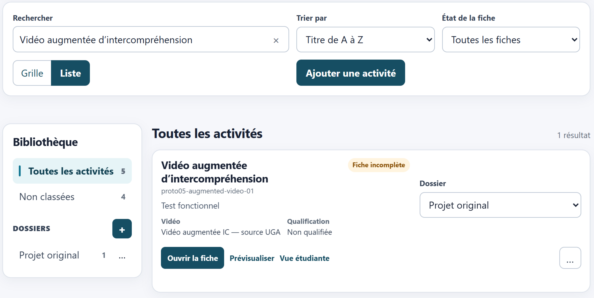
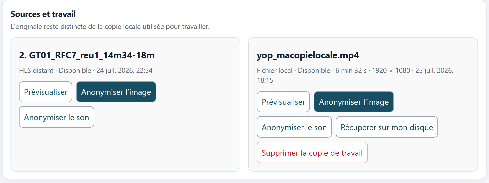
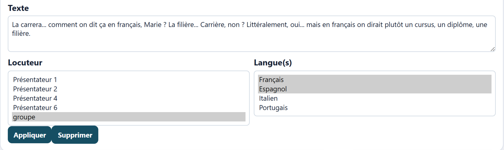

# Vidéo augmentée
## Guide enseignant

Préparer une activité qui associe une vidéo, des passages transcrits et des aides pour observer les échanges entre langues.

**Adresse de l’espace enseignant : [URL PUBLIQUE À COMPLÉTER]**
**Modalités d’accès : [À COMPLÉTER — elles vous seront communiquées.]**

### Un premier parcours avec une activité existante

1. Dans **Bibliothèque**, recherchez le titre de l’activité. Pour l’exemple de ce guide, ouvrez **Vidéo augmentée d’intercompréhension** si elle est mise à disposition.
2. Cliquez sur **Ouvrir la fiche** pour lire sa description et son intention pédagogique. Vous pouvez consulter cette fiche sans la modifier.
3. Cliquez sur **Prévisualisation**. Dans la transcription, choisissez un passage : la vidéo rejoint son début et démarre. Mettez-la en pause pour lire **Annotation IC**.
4. Revenez à la **Bibliothèque**, puis ouvrez **Vue étudiante**. La mention **Vue étudiant · consultation** identifie l’écran destiné aux apprenants.

*La bibliothèque rassemble les activités. Les trois accès en bas de leur carte ouvrent la fiche, la prévisualisation et la consultation étudiante.*

### Retrouver une tâche

Créer, dupliquer, renseigner la fiche : **p. 2** · Choisir la vidéo : **p. 3** · Transcrire dans l’atelier guidé : **p. 4** · Ajouter les aides : **p. 5** · Atelier expert, prévisualisation et partage : **p. 6** · Préparer et anonymiser un média : **p. 7** · Conserver, modifier et supprimer : **p. 8**.

<!-- pagebreak -->

## Créer ou adapter une activité

### Partir d’une copie

Dans la **Bibliothèque**, ouvrez le menu **…** de l’activité puis **Dupliquer**. La copie s’ouvre dans **Auteur expert**. Donnez-lui un titre distinct, puis utilisez **Sauvegarder le brouillon**. Vérifiez ensuite que les deux activités figurent dans la bibliothèque.

La duplication reprend la préparation pédagogique et conserve la référence à la même vidéo. Les textes et enrichissements de la copie peuvent évoluer séparément ; le média n’est pas recopié. Le clic sur **Dupliquer** crée déjà une nouvelle activité, même si vous quittez ensuite l’atelier.

### Partir d’une nouvelle activité

1. Dans la **Bibliothèque**, cliquez sur **Ajouter une activité**.
2. Renseignez **Titre** et **Description**. Dans **Choisir une vidéo dans la Library**, utilisez **Recherche** et **Source** pour retrouver le média.
3. Cliquez sur **Aperçu** pour identifier la version souhaitée, puis sur son bouton **Sélectionner…**. Les identifiants affichés distinguent les accès d’une même vidéo : le choix doit porter sur la version que vous voulez faire lire.
4. Cliquez sur **Créer le brouillon**. L’atelier guidé de la nouvelle activité s’ouvre. Retrouvez son titre dans la bibliothèque pour vérifier la création.

Avant **Créer le brouillon**, quitter cette page abandonne la saisie. Si aucune vidéo ne convient, préparez d’abord son entrée dans la **Vidéothèque** (p. 3 et 7).

### Donner un cadre pédagogique

Ouvrez **Fiche**. Renseignez le titre, la description, la **Consigne apprenant** et la **Question pédagogique générale**, puis précisez le public, les objectifs et les conditions d’utilisation utiles. Par exemple : « Repérez comment le groupe précise le sens d’un mot proche dans deux langues. »

Les choix **Établi**, **Inconnu**, **À vérifier** ou **Non applicable**, lorsqu’ils sont proposés, permettent d’indiquer ce que vous savez réellement. N’utilisez pas une information supposée pour compléter artificiellement la fiche.

Cliquez sur **Enregistrer** et attendez **Activité et fiche pédagogique enregistrées.** Rouvrez la fiche pour vérifier la présence des informations conservées.

> **Lire les états sans les confondre**
> **Fiche complète** décrit le remplissage des informations ; cela ne vaut pas validation pédagogique. Les qualifications et leurs preuves sont distinctes.
> **Brouillon**, **Documentée**, **À requalifier** et **Archivée** décrivent l’état de conception. Ils ne constituent pas une commande de publication ni un verrou d’accès étudiant.

<!-- pagebreak -->

## Choisir la vidéo de l’activité

La **Bibliothèque** contient les activités et leurs enrichissements. La **Vidéothèque** contient les médias, leurs informations et leurs différentes versions. Une vidéo peut servir à plusieurs activités.

### Associer un média déjà disponible

1. Ouvrez **Vidéothèque**. Recherchez la vidéo, puis utilisez **Aperçu** pour vérifier son contenu. **Voir la fiche** donne accès à ses informations et à ses versions.
2. Dans **Activité cible**, choisissez l’activité à préparer.
3. Sur la carte du média, cliquez sur **Associer**. Cette action enregistre directement l’association à l’accès par défaut de cette carte ; elle n’attend pas l’enregistrement dans l’atelier auteur.
4. Attendez le message de confirmation, puis ouvrez la **Prévisualisation** de l’activité. Vérifiez le contenu lu et la correspondance des repères temporels.

Pour choisir précisément une version distante déjà publiée, ouvrez **Voir la fiche**, puis la version voulue dans **Versions publiées** et sa commande **Associer à l’activité**. Choisissez l’activité et confirmez **Associer**.

Changer la vidéo ne réécrit pas automatiquement la transcription et ses repères. Contrôlez les passages, les langues, les annotations et les affichages dans la vidéo après toute association.

### Comprendre les versions d’une même vidéo

*Une même fiche distingue la source originale et la copie utilisée pour travailler. Les commandes proposées dépendent de la version.*

- **Sources et travail** : l’originale et, si elle existe, la copie locale de travail.
- **Dérivations locales** : les versions produites par un traitement, par exemple une anonymisation.
- **Versions publiées** : les références à des versions déjà accessibles à distance. **Ajouter une version publiée** analyse une URL, puis demande de confirmer **Ajouter la version** ; cette commande n’héberge pas le fichier à votre place.

Dans **Modifier la fiche**, les renseignements éditoriaux se conservent avec **Enregistrer**. Vérifiez le message **Fiche enregistrée.** Ces renseignements concernent le média partagé, pas uniquement l’activité en cours.

<!-- pagebreak -->

## Transcrire dans l’atelier guidé

Choisissez **Guidé** pour travailler sur un moment à la fois. **Vidéo et timeline** sert à écouter et à placer le curseur ; **Édition** affiche les champs de l’élément sélectionné.

### Délimiter un moment et saisir ses paroles

1. Lancez la vidéo avec **Lecture**, puis mettez-la en pause près du passage voulu. Les boutons **−5 s**, **−1 s**, **−0,1 s**, **+0,1 s**, **+1 s** et **+5 s** aident à affiner le placement.
2. Cliquez sur **Ajouter un moment ici**. Pour reprendre un moment existant, cliquez sur sa carte dans **Moments de transcription**.
3. Dans **Édition**, réglez **Début** et **Fin**, ou placez la vidéo puis utilisez **Définir le début ici** et **Définir la fin ici**. La fin doit suivre le début et rester dans la vidéo.
4. Renseignez **Texte**, puis sélectionnez le ou les éléments de **Locuteur** et de **Langue(s)**. Dans une liste à choix multiples, utilisez Ctrl sous Windows, ou Cmd sur Mac, pour sélectionner plusieurs valeurs.
5. Cliquez sur **Appliquer**. Vérifiez la carte du moment et ses horaires, puis cliquez sur **Enregistrer les modifications**. Attendez **Modifications enregistrées.**

*Extrait de l’éditeur : paroles transcrites, personnes qui interviennent et langues du passage.*

Dans l’exemple, le moment **3:06 — 3:45** porte sur « carrera ». La vidéo dure plus longtemps que les passages transcrits : une activité peut volontairement documenter certains moments seulement.

### Nommer les personnes qui parlent

Dans **Locuteurs**, utilisez **Ajouter un locuteur**, renseignez son libellé, puis **Appliquer**. Pour corriger un nom existant, utilisez **Modifier**. Associez ensuite ce locuteur aux moments concernés et enregistrez l’activité.

### Repérer les langues dans le temps

Les **Langue(s)** d’un moment décrivent ce passage. Les **Langues entendues** placent des intervalles sur la frise. Utilisez **Ajouter une langue ici**, choisissez la langue et ses bornes, puis **Appliquer** et **Enregistrer les modifications**. Vérifiez sa barre au bon endroit dans la prévisualisation.

<!-- pagebreak -->

## Ajouter des aides à l’observation

Une aide peut attirer l’attention sur un phénomène, poser une question ou afficher un court message dans la vidéo. Elle ne remplace pas la transcription.

### Couches et phénomènes : ce qu’il faut distinguer

Une **couche pédagogique** est une catégorie, par exemple **Mot-piège**. Un **phénomène** est une occurrence de cette catégorie dans un passage précis.

1. Dans **Couches pédagogiques**, cliquez sur **+ Nouvelle couche**, ou sur **Modifier** pour une couche existante.
2. Indiquez son **Nom humain**, sa **Couleur** et sa **Description**. Le choix **Afficher aux étudiants** règle sa visibilité dans la consultation.
3. Cliquez sur **Appliquer**. Dans **Phénomènes**, utilisez **Ajouter un phénomène ici** ; choisissez le segment et la couche, puis renseignez les informations proposées.
4. Appliquez et enregistrez. Dans la prévisualisation, vérifiez l’étiquette du passage et le repère de la frise. Le lecteur peut cocher ou décocher les couches proposées.

Les couches servent à lire les aides pédagogiques. Les masquer côté étudiant ne supprime ni la vidéo ni les paroles transcrites.

### Annotation : accompagner un segment

Dans **Annotations**, choisissez **Ajouter une annotation** ou sélectionnez une annotation existante. Dans **Annotation pédagogique**, choisissez le **Segment**, puis saisissez **Texte** et, si utile, **Question pédagogique**. Cliquez sur **Appliquer**, puis enregistrez.

Dans la prévisualisation, cliquez sur le segment : le bloc **Annotation IC** doit montrer la note et la question pendant le passage. Exemple : « Où voit-on une négociation du sens autour de carrera ? »

### Overlay : afficher un message dans la vidéo

Un **overlay** est un encadré superposé à l’image pendant un intervalle choisi. Dans **Overlays**, cliquez sur **Créer un overlay autonome**, ou sélectionnez un encadré existant.

Renseignez **Titre**, **Texte**, **Début (ms)** et **Fin (ms)**. Ici, 1 000 millisecondes correspondent à une seconde : 186 000 ms correspondent à 3 min 06 s. Vous pouvez sélectionner une **Annotation liée (optionnelle)** et des **Couches**.

Cliquez sur **Appliquer**, puis enregistrez. Lisez le passage en prévisualisation : l’encadré doit apparaître au début prévu et disparaître à la fin. Une annotation sous la vidéo et un overlay sont deux éléments distincts ; créer l’une ne crée pas automatiquement l’autre.

> **Avant de quitter l’atelier**
> **Appliquer** met à jour la préparation dans l’onglet. **Enregistrer les modifications** la conserve pour l’activité. Ouvrez ensuite la prévisualisation pour vérifier le résultat enregistré.

<!-- pagebreak -->

## Vérifier et faire consulter l’activité

### Utiliser l’atelier expert au bon moment

Choisissez **Auteur expert** pour relire ou modifier plusieurs éléments dans leurs tableaux : métadonnées, langues, locuteurs, **Transcription éditable**, **Intervalles linguistiques**, **Phénomènes IC**, couches, annotations et overlays.

Les commandes **Ajouter un segment**, **Ajouter un intervalle** et **Ajouter une occurrence** complètent leurs listes respectives. Les autres sections proposent leurs commandes de création. Respectez les unités indiquées dans les champs, particulièrement les temps en millisecondes.

Après vos changements, cliquez sur **Sauvegarder le brouillon**, puis vérifiez l’état d’enregistrement. **Guidé** et **Auteur expert** travaillent sur la même activité : enregistrez avant de passer de l’un à l’autre. N’éditez pas simultanément la même activité dans plusieurs onglets.

### Prévisualiser le résultat enregistré

1. Cliquez sur **Prévisualisation** après avoir enregistré. Cette vue conserve la navigation enseignante et permet de retourner à l’auteur.
2. Lancez la lecture, puis cliquez sur quelques segments. Vérifiez le texte actif, les personnes et les langues indiquées.
3. Contrôlez les barres de langues, les repères de phénomènes, les notes de **Annotation IC** et les encadrés dans la vidéo.
4. Cochez et décochez une couche, puis rétablissez-la. Vérifiez que les aides attendues sont proposées et que la transcription reste lisible.

Les observations que vous ajoutez en prévisualisation sont temporaires, comme celles du lecteur étudiant. Elles ne deviennent pas des annotations de l’activité.

### Donner le bon accès aux étudiants

Dans la **Bibliothèque**, ouvrez **Vue étudiante**. Depuis l’atelier guidé, **Voir le résultat étudiant** mène aussi à ce parcours ; dans l’atelier expert, utilisez **Ouvrir la vue étudiant**.

Vérifiez la mention **Vue étudiant · consultation** et l’absence des commandes d’auteur. Copiez alors l’adresse de cette page sur l’hébergement prévu pour la consultation.

**Adresse publique de consultation à communiquer : [URL DE L’ACTIVITÉ À COMPLÉTER]**
**Modalités d’accès : [À COMPLÉTER — elles vous seront communiquées.]**

Cette adresse ouvre l’activité enregistrée, avec sa vidéo et ses enrichissements. Elle ne transporte ni votre position de lecture, ni vos observations personnelles, ni les modifications encore non enregistrées. Une adresse de prévisualisation ou de bibliothèque ouvre un autre espace ; une adresse locale à votre ordinateur n’est pas une adresse publique à diffuser.

> **L’état « Brouillon » ne réserve pas l’activité à son auteur**
> Il n’existe pas de publication d’activité qui transforme cet état en droit d’accès étudiant. Les modalités de mise à disposition doivent donc être fixées séparément. Enregistrer des modifications fait évoluer l’activité que les lecteurs retrouveront à son ouverture ou à son rechargement.

<!-- pagebreak -->

## Préparer et anonymiser un média

> **Disponibilité à confirmer selon l’hébergement**
> Les outils de préparation de médias sont présents dans l’interface. Leur disponibilité sur **Alpaga** n’est pas entièrement qualifiée. Faites confirmer les traitements utilisables avant de prévoir une séance qui en dépend.

### Ajouter une vidéo dans la vidéothèque

Cliquez sur **Ajouter une vidéo**, puis choisissez le mode adapté :

- **Ajouter depuis une URL** : saisissez l’**URL HTTP(S)**, cliquez sur **Analyser**, relisez le résultat puis confirmez l’ajout proposé. Cela crée une référence distante, sans télécharger le média.
- **Copier depuis une URL directe** : renseignez l’adresse du fichier vidéo et cliquez sur **Copier l’URL**. Ce mode copie le média ; il exclut les adresses de flux HLS.
- **Ajouter une vidéo locale** : choisissez le **Fichier vidéo**, puis **Importer la copie**. Une copie gérée est créée ; le fichier original reste intact.
- **Ajouter une source déclarative** : renseignez le type et l’adresse, puis **Ajouter la source**. Déclarer une source n’importe pas de fichier et ne prouve pas qu’elle est lisible.

Attendez la fin de l’opération, retrouvez la carte et ouvrez **Aperçu**. Dans **Voir la fiche**, renseignez la provenance, les conditions d’utilisation et les autorisations utiles avec **Modifier la fiche**, puis enregistrez.

### Masquer une zone de l’image

Depuis la fiche vidéo, choisissez la version source, puis **Anonymiser l’image**. Cette commande prépare le travail et peut nécessiter une copie du média. L’atelier **Édition des masques** s’ouvre lorsque la préparation est prête.

Utilisez **Ajouter** pour poser un masque, puis déplacez-le et redimensionnez-le sur l’image. Réglez la **Puissance du flou**. Le masquage est manuel : il n’y a pas de détection automatique des visages. Pour une zone qui change, utilisez les images-clés et **Enregistrer les étapes**, puis vérifiez les positions au fil de la vidéo.

**Valider les masques** conserve les réglages dans la préparation temporaire. **Lancer la dérivation** produit une version transformée. Attendez la fin, puis ouvrez le fichier dérivé et contrôlez le résultat sur toute la durée utile.

### Remplacer un passage sonore

Choisissez **Anonymiser le son** sur la version voulue. Dans l’atelier, placez le début et la fin avec **Définir le début au curseur** et **Définir la fin au curseur**, ou avec **Début (s)** et **Fin (s)**.

Choisissez **Tonalité douce**, **Bip** ou **Silence** dans **Remplacement**, puis **Ajouter ce passage**. Les passages ne doivent pas se chevaucher. Comparez **Son original** et **Aperçu anonymisé** ; cliquez sur **Enregistrer le plan**, puis **Lancer l’anonymisation**. Le lancement enregistre aussi le plan modifié avant le traitement.

Après le message de réussite, ouvrez la version dérivée : le fichier produit reste la référence pour contrôler le son. Le plan audio enregistré est conservé ; un simple réglage non enregistré reste temporaire. Les versions transformées ne sont pas automatiquement diffusées ni associées à toutes les activités.

<!-- pagebreak -->

## Conserver et modifier sans perdre le fil

> **Avant de fermer**
> Enregistrez la fiche ou l’atelier, puis attendez la confirmation. Gardez l’onglet ouvert si l’enregistrement a échoué.
> Conservez ailleurs les textes importants, vos consignes et la référence de la vidéo utilisée. Les observations prises dans la prévisualisation doivent être copiées ou exportées séparément.
> Recharger ou fermer abandonne les saisies non enregistrées et les observations temporaires. Une adresse copiée n’est pas une sauvegarde de ces éléments.

### Quelle action conserve quoi ?

| Action | Effet à retenir |
| --- | --- |
| Appliquer dans l’atelier guidé | Met à jour le travail de l’onglet ; enregistrez ensuite l’activité. |
| Enregistrer / Enregistrer les modifications / Sauvegarder le brouillon | Conserve les informations de l’écran auteur concerné. Une erreur signifie que la conservation n’est pas confirmée. |
| Associer dans la vidéothèque | Enregistre immédiatement le choix de vidéo pour l’activité cible. |
| Changer le Dossier d’une activité dans la bibliothèque | Enregistre directement son classement. Les vues Grille/Liste sont une préférence du navigateur. |
| Modifier la fiche d’un média | Nécessite Enregistrer ; les informations concernent ce média partagé. |
| Cocher une couche, lire, prendre des observations | Modifie la consultation de cet onglet, sans suivi de progression ni remise de travail. |

Si une version plus récente a été enregistrée ailleurs, un conflit peut empêcher votre sauvegarde. Conservez votre texte à part avant **Recharger la version actuelle** : cette commande reprend la version enregistrée et abandonne les changements locaux.

### Mesurer l’effet d’une suppression

- **Segment dans l’atelier guidé** : le dialogue précise les éléments liés. Sa suppression retire aussi les phénomènes et annotations rattachés, ainsi que les overlays liés à ces annotations. Les intervalles de langues sont conservés et détachés du segment. Enregistrez pour confirmer ces changements.
- **Couche ou locuteur encore utilisé** : la suppression peut être refusée. Corrigez les références concernées avant de recommencer ; masquer une couche aux étudiants ne la supprime pas.
- **Activité** : dans le menu **…**, **Supprimer** demande confirmation. La suppression de l’activité est définitive ; elle ne supprime pas automatiquement sa vidéo. Des dépendances peuvent la bloquer.
- **Média** : **Retirer l’entrée de la vidéothèque** et **Retirer l’entrée et supprimer le fichier**, lorsqu’elles sont proposées, n’ont pas la même portée. Les copies et les tentatives ont aussi leurs propres commandes de suppression. Lisez le dialogue et les dépendances : certaines actions suppriment réellement un fichier local.

Une vidéo réutilisée concerne plusieurs activités. Avant de changer ses accès ou de supprimer une version, consultez **Activités utilisant la vidéo** et les autres dépendances de sa fiche. Vérifiez ensuite chaque activité concernée. Supprimer un dossier de classement conserve ses éléments et les rend non classés.
