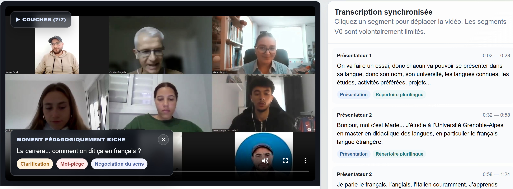
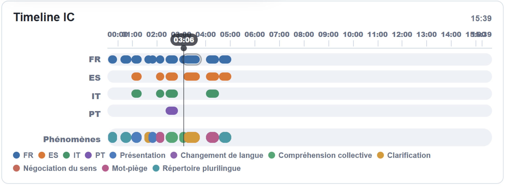
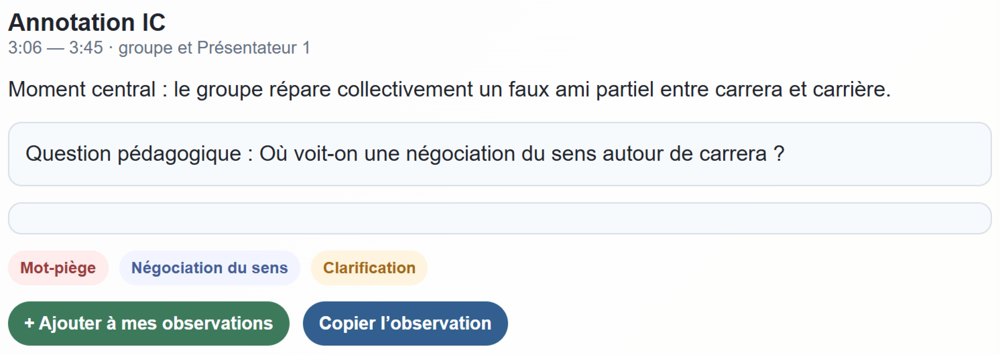

# Vidéo augmentée
## Guide étudiant

Explorez un échange plurilingue : écoutez un passage, suivez ses paroles et utilisez les aides pour préciser ce que vous comprenez.

**Adresse de votre activité : [URL PUBLIQUE DE CONSULTATION À COMPLÉTER]**
**Modalités d’accès : [À COMPLÉTER — elles vous seront communiquées.]**

### Commencer avec un passage

1. Ouvrez l’adresse qui vous a été transmise. Vérifiez le titre de l’activité et la mention **Vue étudiant · consultation**.
2. Attendez que la vidéo soit prête, puis utilisez le bouton de lecture du lecteur. Son bouton de pause permet d’arrêter l’image pour réfléchir.
3. Dans **Transcription synchronisée**, cliquez sur un passage. La vidéo rejoint son début et démarre ; le passage actif est mis en évidence.
4. Mettez la vidéo en pause et descendez jusqu’à **Annotation IC**. Lisez l’aide et la question, si elles sont proposées pour ce moment.

*À gauche, la vidéo et ses aides superposées ; à droite, les passages de la transcription. Le bloc Annotation IC et la frise se trouvent plus bas.*

L’exemple de ce guide est **Vidéo augmentée d’intercompréhension**. À **3:06 — 3:45**, les participants cherchent une traduction de « carrera ». Votre activité peut proposer d’autres passages, langues et questions.

### Retrouver une explication

Se déplacer et lire la frise : **p. 2** · Utiliser les aides et régler l’affichage : **p. 3** · Noter et conserver ses observations : **p. 4**.

<!-- pagebreak -->

## Écouter et retrouver un moment

### Lire, mettre en pause, revenir en arrière

Utilisez les commandes du lecteur vidéo pour lire, mettre en pause, régler le volume ou déplacer le curseur sur la barre de lecture. Après un déplacement, vérifiez le temps affiché et reprenez la lecture si nécessaire.

Dans **Transcription synchronisée**, chaque carte associe un ou plusieurs locuteurs, des horaires et un texte. Cliquer sur la carte relance le passage à son début. Pendant la lecture, le repère actif suit les moments disponibles ; vous pouvez faire défiler la liste pour retrouver un autre passage.

La transcription peut couvrir seulement une partie de la vidéo. Un moment sans carte active ou sans annotation ne signifie pas que la lecture est en panne.

### Lire la frise « Timeline IC »

*Le curseur est ici à 3:06. Les barres colorées repèrent les langues ; la ligne Phénomènes rassemble les aides à l’observation.*

| Repère | Comment le lire |
| --- | --- |
| Horaires en haut et curseur vertical | Ils situent le moment de lecture dans la durée de la vidéo. |
| FR, ES, IT, PT dans cet exemple | Français, espagnol, italien et portugais. Chaque barre délimite un intervalle associé à une langue. |
| Phénomènes | Des repères comme Mot-piège, Clarification ou Négociation du sens signalent ce qui peut être observé. La légende donne les couleurs. |

Cliquez sur une barre de langue pour rejoindre son début. Le curseur se déplace ; si la vidéo est en pause, relancez-la avec le lecteur. Les repères de phénomènes permettent aussi de retrouver le moment concerné.

Plusieurs langues peuvent apparaître pendant un même passage. Les repères indiquent les éléments préparés pour l’activité : ils ne constituent ni une traduction complète ni une évaluation de votre compréhension.

<!-- pagebreak -->

## Explorer les aides à la compréhension

### Lire une annotation et sa question

Sélectionnez un passage de la transcription, mettez la vidéo en pause, puis consultez **Annotation IC** sous le lecteur. Vous y retrouvez les horaires, les locuteurs et, selon le moment, une note et une **Question pédagogique**.

*L’aide attire ici l’attention sur la recherche collective d’un mot français. Vous pouvez garder une observation à partir de ce passage.*

Pour répondre à la question, réécoutez le passage et relevez les mots ou les reformulations qui vous aident. Par exemple, repérez les propositions « carrière », « cursus » et « filière », puis expliquez ce que l’échange permet de préciser.

### Choisir les couches visibles

Dans la vidéo, ouvrez **Couches actives** si le panneau est replié. Une couche correspond à une catégorie d’aide, par exemple **Mot-piège** ou **Clarification**.

Décochez une catégorie pour masquer ses étiquettes et les repères associés, puis recochez-la pour les retrouver. Le nombre affiché quand le panneau est replié indique combien de couches sont actives.

Les paroles de la transcription restent disponibles, même si toutes les couches sont décochées. Les annotations sous la vidéo ne sont pas filtrées par ces cases. Ces réglages d’affichage ne modifient pas l’activité.

### Dégager l’image

- Cliquez sur le titre **Couches actives** pour replier le panneau ; cliquez de nouveau pour retrouver les cases.
- Un encadré peut apparaître dans la vidéo au moment prévu pour une aide. Sa croix **×** le ferme pour ce moment ; elle n’efface pas le passage ni l’annotation sous le lecteur.
- **Mode Focus** agrandit la place donnée à la vidéo et masque la transcription, la frise et le bloc d’annotations avec les observations. **Quitter le focus** rétablit ces zones.

Vous pouvez ainsi écouter d’abord avec une image dégagée, puis revenir à l’affichage complet pour comparer le son, le texte et les aides.

<!-- pagebreak -->

## Noter et conserver ses observations

### Ajouter un passage à son tableau

1. Sélectionnez le passage à conserver dans **Transcription synchronisée**. Vérifiez ses horaires dans **Annotation IC**.
2. Cliquez sur **+ Ajouter à mes observations**. Le message **Observation ajoutée au tableau.** apparaît et le compteur de **Mes observations** augmente.
3. Dépliez **Mes observations** si nécessaire. La ligne reprend les horaires, le locuteur, un aperçu du texte, les langues et les catégories d’aide.
4. Dans **NOTE PERSONNELLE**, saisissez ce que vous voulez retenir. Exemple : « Le groupe propose plusieurs mots pour préciser le sens de carrera. » Sur un écran étroit, faites défiler le tableau horizontalement pour atteindre cette colonne.

La croix **×** d’une ligne retire cette observation du tableau. Ajouter deux fois le même passage crée deux lignes : vous pouvez retirer celle qui fait doublon.

### Garder une copie en dehors de l’activité

**Exporter CSV** télécharge le tableau d’observations, avec vos notes personnelles. Attendez **Export CSV généré.**, puis retrouvez le fichier dans les téléchargements du navigateur et ouvrez-le dans un tableur. Vérifiez que les notes à garder y figurent avant de fermer l’activité. Le tableau à l’écran abrège les paroles longues ; l’export conserve leur texte complet.

Le CSV contient les informations des lignes et vos notes, pas le texte des annotations pédagogiques ni leurs questions. Pour conserver l’aide du passage sélectionné, utilisez **Copier l’observation**, puis collez le contenu dans votre document de notes. Vérifiez le collage ; cette commande ne copie pas votre tableau de notes personnelles.

> **Avant de recharger ou de fermer l’onglet**
> Gardez l’activité ouverte tant que vos observations importantes ne sont pas copiées ou exportées ailleurs.
> Les notes du tableau sont conservées uniquement dans la mémoire de cet onglet. Elles ne sont pas sauvegardées avec l’activité, envoyées à l’enseignant ni retrouvées dans un autre onglet.
> Un rechargement ou une nouvelle ouverture réinitialise la position de lecture, les réglages d’affichage et les observations. L’adresse de l’activité ne mémorise pas votre travail.

### Si quelque chose manque

Si l’image ou le son ne démarre pas, vérifiez les commandes du lecteur et les indications sous la vidéo. Si un message d’indisponibilité persiste, signalez-le à la personne qui vous a donné l’accès, avec le titre de l’activité.

Si un passage n’a pas d’aide, choisissez un autre moment transcrit. Si les étiquettes manquent, vérifiez les couches cochées. Si les panneaux ont disparu, utilisez **Quitter le focus**. Avant tout rechargement, gardez vos observations ailleurs.
